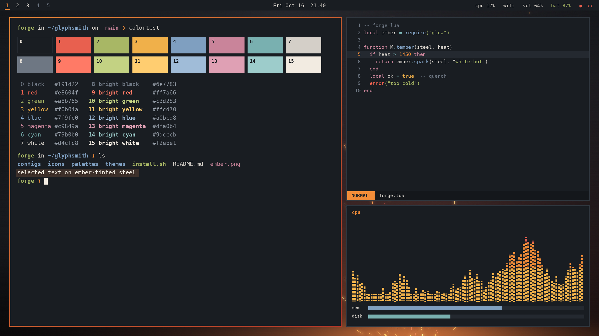
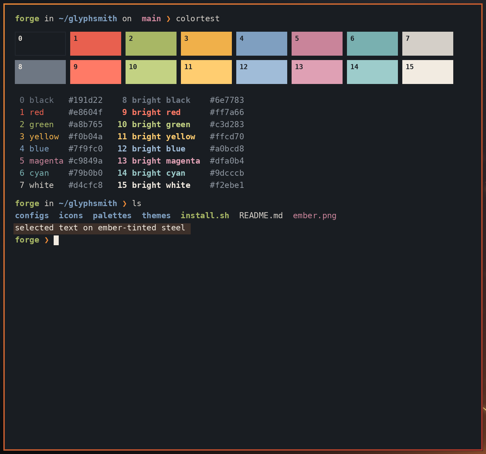
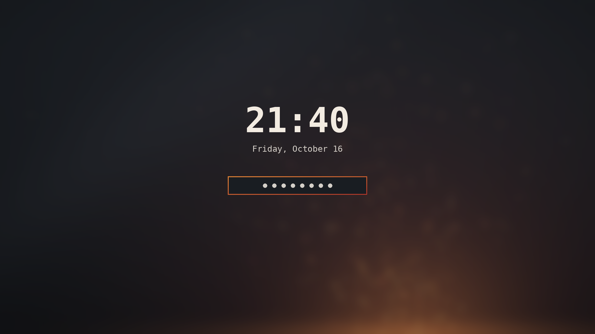

# Steel & Ember

Dark and warm, like forged steel and glowing ember: a blue-grey charcoal base with ember orange, amber and forge-red accents.

**Version:** 0.1.0 · **For:** Omarchy (Hyprland) 4.0+ · **Mode:** dark



## Screenshots

| Terminal + editor | Lock screen |
|---|---|
|  |  |

## What it themes

Omarchy 4 renders every app config from `colors.toml`, so this theme ships a palette rather than
per-app files. Switching to it colours:

- **Hyprland** window borders: an ember gradient (`#f28c38` to `#b8382a`, 45°) on the active window, dim steel on inactive ones
- **Omarchy shell**: top bar, menus, launcher, notifications, OSD, polkit prompt and lock screen (the lock and polkit borders reuse the ember gradient)
- **Terminals**: Alacritty, Ghostty, Kitty and Foot (all 16 ANSI colours)
- **Editors**: Neovim (aether), Helix, VS Code/Cursor (generated theme), Obsidian
- **btop**: a hand-tuned `btop.theme` with amber-to-red CPU and upload graphs and steel-blue memory and network graphs
- **Chromium/Brave** toolbar colour, the keyboard backlight (ember orange where supported), fcitx5, gum, and the other templated apps
- **GTK icons**: `Yaru`, whose orange accent matches the ember
- **Wallpaper**: `backgrounds/1-forged-steel.png` (2560x1440), brushed dark steel with an ember glow and rising sparks

## Theme files

| File | Purpose |
|---|---|
| `colors.toml` | The palette. Omarchy renders Hyprland, terminal, shell, editor and app configs from it |
| `btop.theme` | Colour-only btop override with ember graphs (kept by every install method) |
| `icons.theme` | GTK icon theme name (`Yaru`) |
| `backgrounds/1-forged-steel.png` | Default wallpaper |
| `preview.png` | Theme picker preview |
| `screenshots/` | Images for this README |
| `install.sh`, `uninstall.sh` | Optional installer for the release tarball |

## Palette

| Role | Hex | | Role | Hex |
|---|---|---|---|---|
| background | `#191d22` | | foreground | `#d4cfc8` |
| dark_background | `#14171b` | | light_foreground | `#e3ddd4` |
| darker_background | `#0e1013` | | bright_foreground / cursor | `#f2ebe1` |
| lighter_background | `#242930` | | dark_foreground | `#8f97a1` |
| selection | `#3d302a` | | muted (comments, bright black) | `#6e7783` |
| accent / orange | `#f28c38` | | brown | `#7a3f1d` |
| border active | `#f28c38` → `#b8382a` | | border inactive | `#3a424c` (aa alpha) |

| ANSI | Normal | Bright |
|---|---|---|
| black | `#191d22` (0) | `#6e7783` (8) |
| red | `#e8604f` (1) | `#ff7a66` (9) |
| green | `#a8b765` (2) | `#c3d283` (10) |
| yellow / amber | `#f0b04a` (3) | `#ffcd70` (11) |
| blue | `#7f9fc0` (4) | `#a0bcd8` (12) |
| magenta | `#c9849a` (5) | `#dfa0b4` (13) |
| cyan | `#79b0b0` (6) | `#9dcccb` (14) |
| white | `#d4cfc8` (7) | `#f2ebe1` (15) |

All text colours reach at least 4.5:1 against the background. Bright black `#6e7783` is 3.7:1 and is meant
for comments and dim text. ANSI 0 is the background itself, the Omarchy convention.

## Requirements

- Omarchy 4.0 or newer (Omarchy 4 renders app configs from `colors.toml`)
- `git` (for the git and `omarchy-theme-install` methods)
- Optional: icon theme `Yaru` (named in `icons.theme`)
- No root access needed

## Install

Pick one method.

**1. Omarchy's installer (recommended)**

```bash
omarchy-theme-install https://github.com/synthalorian/omarchy-steel-and-ember-theme
```

**2. Git clone into the themes folder**

```bash
git clone https://github.com/synthalorian/omarchy-steel-and-ember-theme ~/.config/omarchy/themes/steel-and-ember
omarchy-theme-set steel-and-ember
```

**3. Release tarball with the bundled installer** (backs up any existing theme of the same name and writes a manifest)

```bash
tar -xzf steel-and-ember-0.1.0.tar.gz
cd steel-and-ember
./install.sh --dry-run   # preview
./install.sh --apply     # install and switch to it
```

Checksum: `sha256sum -c steel-and-ember-0.1.0.tar.gz.sha256`

**4. Copy it by hand** (a plain copy without `.git` counts as your own theme, so Omarchy uses every file)

```bash
cp -r steel-and-ember ~/.config/omarchy/themes/steel-and-ember
omarchy-theme-set steel-and-ember
```

> Themes installed with git (methods 1 and 2) only take colour files: Omarchy ignores `*.lua`, terminal
> configs and `vscode.json` from git repos for safety. This theme puts everything into `colors.toml`, so
> every method gives the same result.

## Uninstall

- Installed with method 1, 2 or 4: switch to another theme, then `omarchy-theme-remove steel-and-ember`
- Installed with method 3: `./uninstall.sh` (switches away if the theme is active, removes only the files it added and restores your backup). Use `./uninstall.sh --dry-run` to preview.

## Changelog

See [CHANGELOG.md](CHANGELOG.md).

## License

MIT © 2026 synthalorian. See [LICENSE](LICENSE).

## Credits

- Design and packaging: synthalorian
- Thanks to the aether.nvim project, whose colorscheme Omarchy uses to theme Neovim
- Wallpapers: `1-forged-steel.png` is original procedural artwork by synthalorian (MIT, same as the theme)
- Built for [Omarchy](https://omarchy.org) by DHH and contributors
